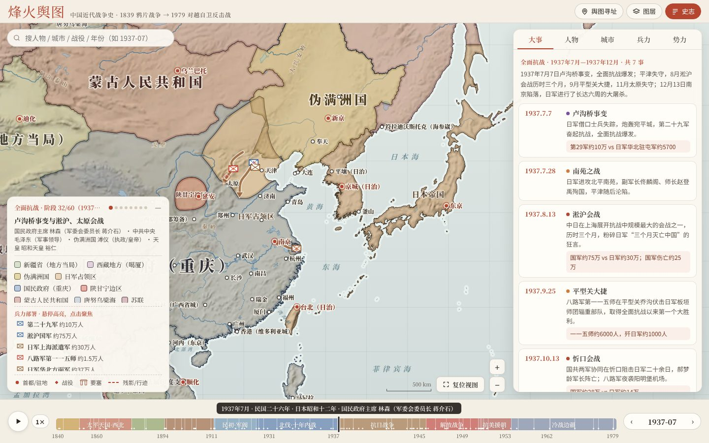
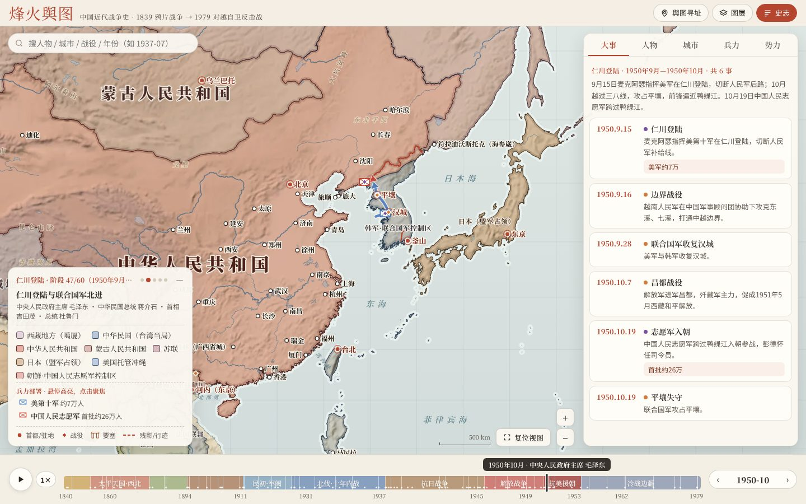
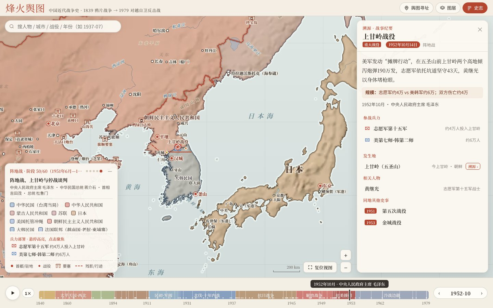
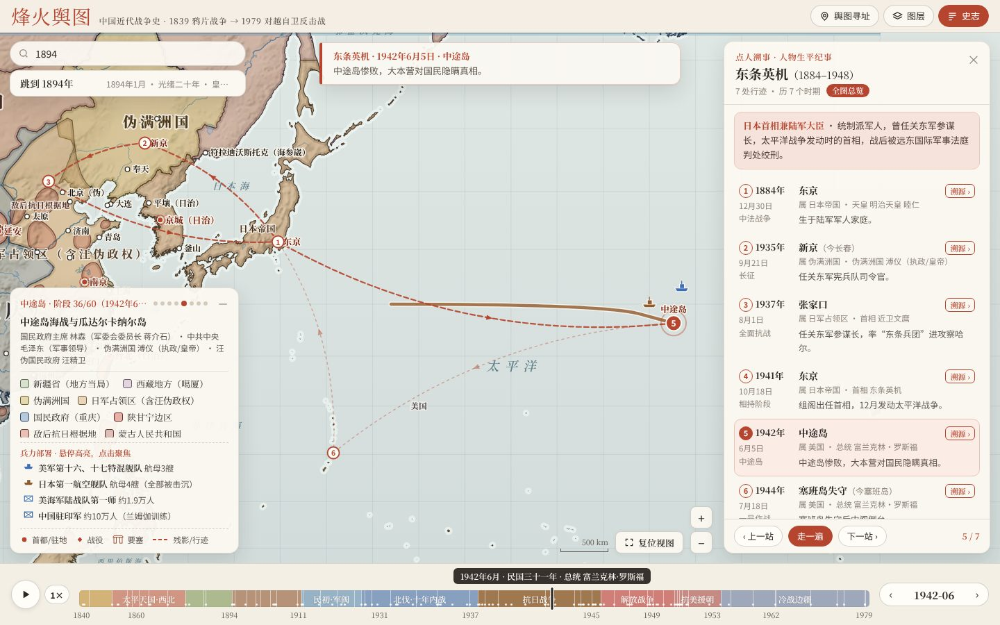
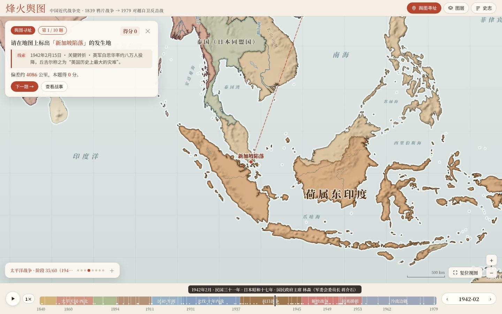
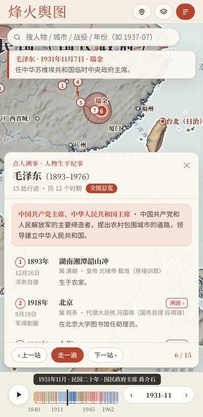

# 烽火舆图 · 中国近代战争史交互地图

> 拖动时间轴，从 1839 年虎门销烟一路看到 1979 年对越自卫反击战。

一张能在浏览器里拖动的中国近代战争史地图。时间拖到哪一天，地图就变成那一天的局面：各方控制区、兵力部署、进军路线、战役、人物行迹都跟着变。

整个应用是**一个 HTML 文件**，不需要服务器，也不需要安装任何东西：下载 `index.html`，双击就能打开。



## 功能

### 1. 拖时间轴，看天下分合

- 底部时间轴从 **1839 年鸦片战争**到 **1979 年对越自卫反击战**，分为 **60 个时期**。抗战、解放战争、朝鲜战争按月细分，例如朝鲜战争的战线就分了五个阶段：釜山防御圈、仁川登陆、志愿军入朝、拉锯战和阵地战。
- 时间轴上方实时显示**公历年月 · 年号或民国纪年 · 日本年号 · 当时的统治者**，例如「1894年9月 · 光绪二十年 · 日本明治二十七年 · 皇帝 光绪帝」。
- 左下角图例列出当时的**各方政权**和**兵力部署**（部队、舰队、要塞、航空兵，附指挥官、兵力、装备）。鼠标放上去，对应的政权或部队会高亮；点一下，地图就飞过去。
- **虚线残影**：每次跨入新时期，上一阶段的边界会以朱砂色虚线短暂留在地图上；鼠标掠过时间轴上的任何一段，也会预览那个时期的边界。



### 2. 点城市或战役，弹出「溯源」卡片

- **城市**：收录 168 座城市，北京、上海、南京、平壤、汉城、东京、河内、西贡等都有。卡片按时期列出这座城当时叫什么（北京→北平→北京、奉天→沈阳、长春→新京、汉城→京城→汉城……）、归谁管、是不是首都或驻地，以及在这里发生过的战事（附概述和规模）、到过这里的人物。点任何一条，时间轴立刻跳到那一天。
- **战役**：收录 265 条大事，分为重大战役、重要战斗、关键转折、历史事件、条约外交五类。卡片给出日期、概述、**规模**（参战兵力与伤亡）、参战部队、发生地、相关人物，以及同一地点的其他战事。
- **要塞关隘**：虎门、大沽口、旅顺、刘公岛、镇南关、山海关、平型关、泸定桥、上甘岭、金门、珍宝岛等 24 处单独标出。
- 点击地图上任何一处陆地，也会给出「此地历代归属」。



### 3. 点人溯事，跟着历史人物走一遍

- 人物库收录 **56 位**：道光帝、林则徐、关天培、洪秀全、曾国藩、李鸿章、左宗棠、邓世昌、慈禧、孙中山、袁世凯、蔡锷、张作霖、张学良、蒋介石、毛泽东、周恩来、朱德、彭德怀、刘伯承、邓小平、粟裕、杨靖宇、张自忠、李宗仁、孙立人、戴安澜、伊藤博文、东乡平八郎、山本五十六、东条英机、冈村宁次、麦克阿瑟、史迪威、艾森豪威尔、金日成、李承晚、胡志明、武元甲、黄继光、杨根思、许世友、杨得志……
- 搜索人物，地图用弧线把他一生的行迹串起来，可以逐站走，也可以「走一遍」自动播放。走到哪一站，年份、纪年、当地的统治者和各方版图全部跟着变，屏幕上方显示这一站的生平或名句。比如走到东条英机的「中途岛」一站，地图就是太平洋战争的格局，同时标出中途岛海战双方的舰队。



### 4. 彩蛋：舆图寻址小试

点右上角「舆图寻址」：十道题，城市与战役标注全部隐去，只给出「甲午海战」「平型关大捷」「九一八事变」这样的线索，你在地图上落针，按距离计分。答完按总分授予军衔，从「列兵」一路到最高一档「**大元帅**」。



### 5. 重要事件字幕与录屏

- 重大战役、重要战斗、关键转折发生后，标题、日期和一句概述会以字幕卡的形式浮现在发生地旁边，随时间淡出；字幕会自动避开地名、城市和图标。
- **录屏**（右上角）：可录“手动操作”“时间轴自动播放”“当前时期自动播放”“当前人物走一遍”。录像含日期、时期、政权图例和人物字幕，保存在浏览器的「录像库」中，可回放、导出；在 Chrome / Edge 中还可选择一个本地文件夹，之后每次录完自动写入该文件夹。

### 其他

- 搜索：人物、城市古今名、战役、要塞、政权、时期，也可以输入日期，例如 `1950-10`、`1937年7月`。
- 图层：地形晕渲、河流湖泊、现代国界、现代省界、兵力部署、进军路线、城池、要塞关隘、大事标记、山川地名、虚线残影。
- 快捷键：`空格` 播放；`←/→` 跳到上一场/下一场战事（行迹模式下为上一站/下一站）；`Shift+←/→` 前后一年；`/` 搜索；`Esc` 关闭卡片。
- 手机竖屏可用：史志面板变成底部抽屉，图例可以收起。



## 文字显示与跨平台

- 网络字体（思源宋体 Noto Serif SC、马善政楷体）通过脚本**异步加载，不会阻塞页面**。在无法访问 Google Fonts 的网络环境（例如中国大陆）中，页面会直接使用系统字体：macOS / iOS 用宋体-简（Songti SC）、苹方，Windows 用宋体、微软雅黑，Android / Linux 用思源（Noto CJK）字体。
- 在 Windows 上，如果网络字体没有加载成功，地图上的粗体标注会自动改用微软雅黑，避免宋体加粗后发虚。
- 界面中的按钮图标都用 SVG 绘制，不使用在 iOS 上会变成彩色 emoji 的符号（例如 ▶）。
- 地图上的文字按需加载字形：只请求当前画面上实际出现的汉字，减少流量。

## 发布到 GitHub Pages

把仓库推到 GitHub → **Settings → Pages** → Source 选 `Deploy from a branch`，分支选 `main`、目录选 `/ (root)`。几分钟后即可通过 `https://<用户名>.github.io/<仓库名>/` 访问。

## 从源码构建

`index.html` 是构建产物，已经提交在仓库里。修改史料或样式后按下面的步骤重新生成：

```bash
# 依赖：Node.js 18+、Python 3.9+（numpy、Pillow）、curl
npm install
pip install numpy pillow

npm run fetch     # 下载 Natural Earth 省级行政区、河流、湖泊、地理区域与 NASA 高程图（约 60 MB）到 raw/
npm run build     # 生成底图与各时期政权轮廓 → 地形晕渲 → 打包成 index.html
npm run serve     # 可选：本地预览 http://localhost:8000
```

| 步骤 | 脚本 | 输出 |
| --- | --- | --- |
| 底图与政权轮廓 | `scripts/build-geo.js` | `build/geo.json`、`build/data.json` |
| 地形晕渲 | `scripts/build-relief.py` | `build/relief.webp` |
| 打包 | `scripts/bundle.py` | `index.html` |

各时期的控制区由 Natural Earth 1:10m **省级行政区**拼合，再与手绘的战线、根据地、占领区多边形求并、求差得到；相同的轮廓只存一份，几何用 0.01° 精度的增量编码压缩。

## 目录结构

```
index.html            构建好的单文件应用
src/head.html         页面骨架与样式
src/app.js            交互与 Canvas 绘图
data/stages.js        60 个时期与各方控制区（政权实体 + 时间版本）
data/events.js        大事库（战役、战斗、转折、事件、条约）
data/forces.js        兵力部署、进军箭头、要塞关隘、寻址题库
data/cities.js        城市：古今名称、存续年代、首都与驻地
data/people.js        人物行迹与名句
data/rulers.js        年号、民国纪年、日本年号与各国统治者
data/time.js          日期 ↔ 小数年
data/assemble.js      汇总
scripts/              构建脚本
```

## 史料格式（方便补充）

```js
// 大事：[日期, 经度, 纬度, 标题, 类别(M/B/T/E/P), 概述, 规模]
['1937-09-25', 113.73, 39.27, '平型关大捷', 'B', '八路军第一一五师在平型关乔沟伏击……', '一一五师约6000人，歼日军约1000人']

// 兵力：[起, 止, 名称, 阵营, 类型(army/fleet/fort/air), 经度, 纬度, 指挥官, 兵力, 装备]
['1894-07-25', '1895-04-17', '北洋水师', 'qing', 'fleet', 123.7, 39.3, '丁汝昌', '主力舰12艘', '定远、镇远等']

// 进军箭头：[起, 止, 阵营, 名称, [[经,纬], ...]]
['1950-09-15', '1950-10-25', 'un', '仁川登陆', [[125.6, 37.2], [126.62, 37.47], [126.98, 37.57]]]

// 城市：[id, 经, 纬, 始见, 终止(9999=今存), 等级, [[起年, 名称]...], [[起, 止, 首都/驻地]...]]
['changchun', 125.32, 43.88, 1800, 9999, 1, [[1800,'长春'],[1932.2,'新京'],[1945.7,'长春']], [[1932.2,1945.63,'伪满洲国']]]

// 人物站点：[日期, 经, 纬, 地点, 事迹, 名句(可选)]
['1937-07-17', 115.97, 29.55, '庐山', '发表庐山谈话，宣布全面抗战。', '“如果战端一开……”——庐山谈话']
```

政权在 `data/stages.js` 的 `E` 数组中定义，每个政权有若干时间版本，几何写法如下：
`'CN'` 整个国家，`'CN.Hebei'` 一个省，`'-CN.Taiwan'` 扣除，`{ m: 'CN.Inner Mongol', p: 多边形 }` 取省的一部分，`{ p: 多边形 }` 手绘区域，`{ p: 多边形, neg: true }` 扣除手绘区域。改完运行 `npm run build`。

## 数据来源与许可

| 数据 | 来源 | 许可 |
| --- | --- | --- |
| 国界、省级行政区、河流、湖泊、山脉 | [Natural Earth](https://github.com/nvkelso/natural-earth-vector) 1:10m | 公有领域 |
| 地形晕渲 | NASA 高程凹凸图（经 [turban/webgl-earth](https://github.com/turban/webgl-earth)） | 公有领域 |
| 字体 | 思源宋体 Noto Serif SC、马善政 Ma Shan Zheng（Google Fonts） | SIL OFL |
| 各时期控制区、兵力、战役、人物、纪年 | 作者依据通行史书与公开资料整理 | MIT（随本项目） |

人物名句取自公开发表的原文（奏折、遗嘱、演说等），外文名句为作者自译或转述，已在条目中注明。

## 说明与局限

- **控制区为示意**：边界多以现代省界为基础拼合，战线与根据地是手绘的近似轮廓；实际控制往往是点和线，而不是整片区域。
- 战役规模、兵力、伤亡数字各方史料出入很大，这里取常见说法，仅供参考。
- 60 个时期是离散断面，同一时期内的变化无法逐日体现。
- 现代国界与省界为今日划分，仅作底图参考。
- 欢迎提 Issue 或 PR 补充或订正。

## 致谢

交互形式受 [DeanChensj/jiangshan-map（江山时序）](https://github.com/DeanChensj/jiangshan-map) 启发：时间轴、虚线残影、点地溯源、点人溯事与舆图寻址这几个玩法都借鉴自它。本项目代码为独立编写，未复制其源码。

## 许可

[MIT](LICENSE) © 2026 实诚
